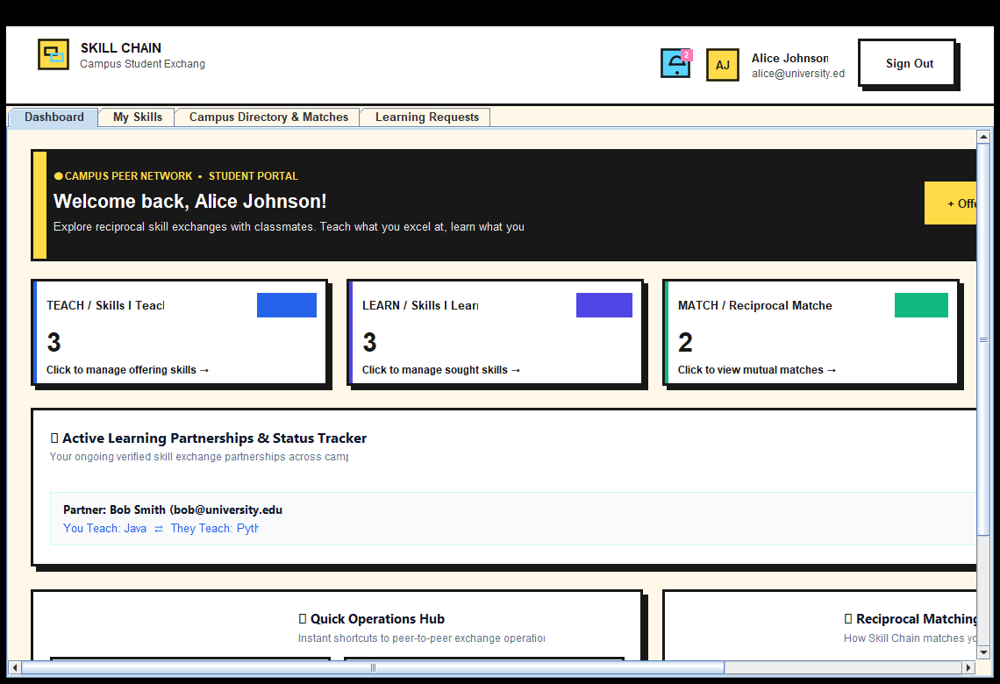
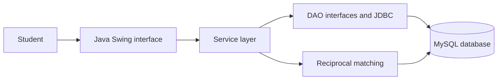

# Skill Chain

### Trade what you know. Learn what you don't.

Skill Chain is a campus skill-exchange application built with Java Swing and MySQL. Students list the skills they can teach and the skills they want to learn. The app finds pairs where the interest is mutual, then lets them send and manage an exchange request.



## The idea in one example

Alice can teach Java and wants to learn Python. Bob can teach Python and wants to learn Java. Skill Chain recognizes the two-way fit and shows them as a reciprocal match. Each student can then send, receive, accept, or reject a learning request in the app.

## What students can do

- Create an account and manage a personal skill portfolio.
- Add skills to teach or skills to learn, organized by category.
- Browse the campus directory and find reciprocal skill matches.
- Send learning requests and follow their pending, accepted, or rejected status.
- Review incoming and outgoing requests and see in-app notifications.

## How the application is put together



The matching query checks both sides of a potential exchange: a student's teaching skill must be something the peer wants, and the peer's teaching skill must be something the student wants. The result comes from the stored student and skill records.

## Java and OOP in the project

| Concept | Where it appears |
|---|---|
| Encapsulation | Domain objects keep their state behind fields and methods. |
| Abstraction | `Person` defines shared student behavior. |
| Inheritance | `User` and `PeerStudent` build on `Person`. |
| Polymorphism | Student types provide their own implementations of inherited behavior. |
| Packages | `model`, `dao`, `service`, `ui`, and `util` separate project responsibilities. |
| Exception handling | Domain exceptions identify cases such as duplicate records and invalid login; database errors are handled at the application boundary. |

DAO interfaces separate the service logic from JDBC persistence. Database calls use prepared statements and try-with-resources.

## Database design

The MySQL schema uses primary keys, foreign keys, unique constraints, and indexes across four main tables:

| Table | Purpose |
|---|---|
| `users` | Student accounts and profile details. |
| `skills` | Shared catalogue of skills and categories. |
| `user_skills` | Links each student to skills they teach or want to learn. |
| `learning_requests` | Records the offered/requested skills, participants, request status, and approval time. |

The app demonstrates create, read, update, and delete operations through registration, skill portfolios, and learning requests.

## Run it locally

### You need

- JDK 17 or later
- MySQL 8.0 or later
- Maven, or Windows for the included batch scripts

### Start the application

1. Run [`schema.sql`](schema.sql) in MySQL. It creates `skill_chain_db`, its tables, and sample data for a classroom demonstration.
2. Copy `config.properties.example` to `config.properties` and set `db.url`, `db.user`, and `db.password` for your local MySQL account. The local config file is excluded from Git.
3. From the project folder, run:

   ```bash
   mvn exec:java
   ```

   On Windows, `run.bat` is also available.

The sample students in `schema.sql` share the classroom password `Password123!`. Use these accounts for demonstration only.

## Project material

- [Final project report](Skill_Chain_Final_Project_Report.pdf)
- [Report chapters in Markdown](docs/FINAL_PROJECT_REPORT.md)
- [CRUD demonstration guide](docs/CRUD_DEMONSTRATION.md)
- [Application screenshots](screenshots/)

## Built with

Java 17 · Swing · JDBC · MySQL 8 · Maven
