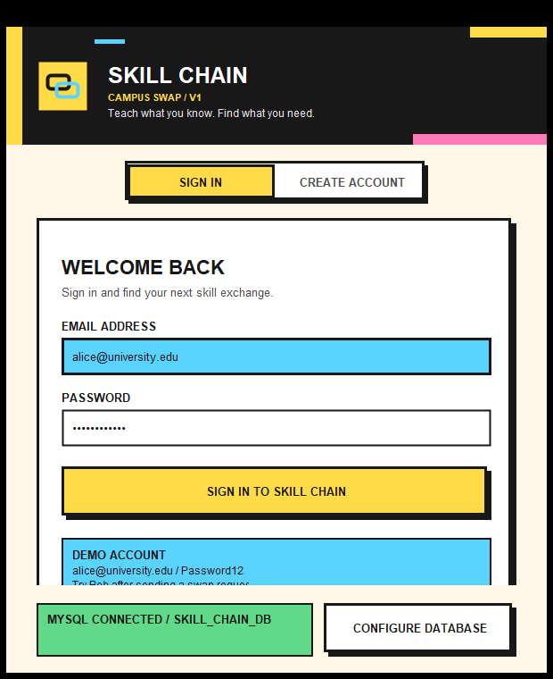
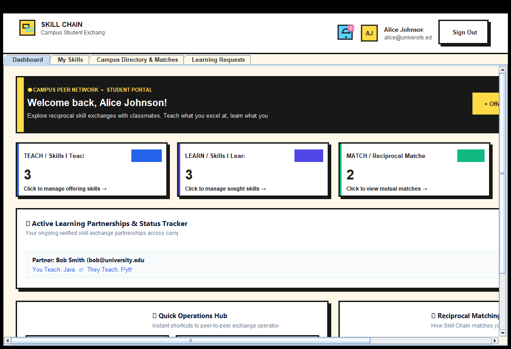
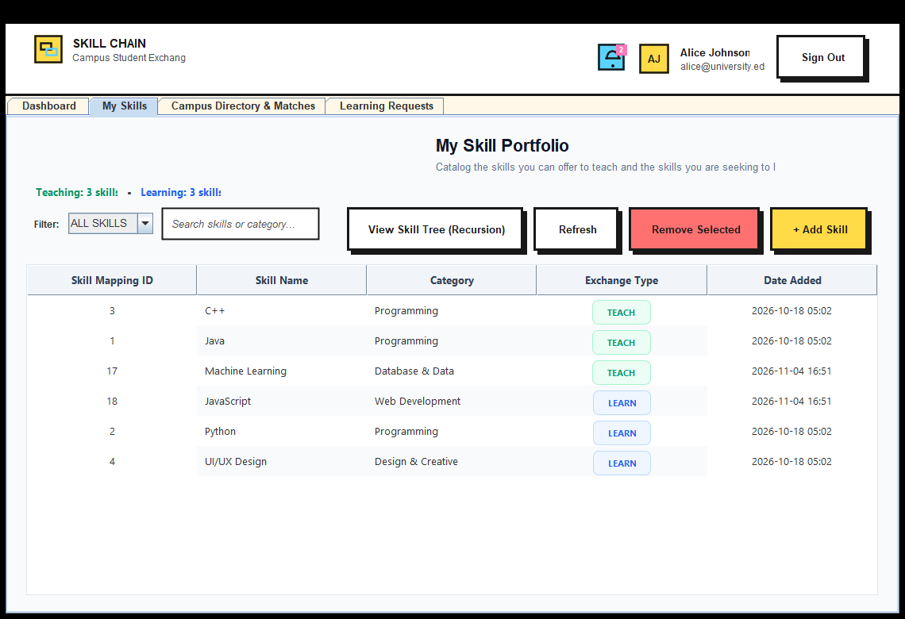
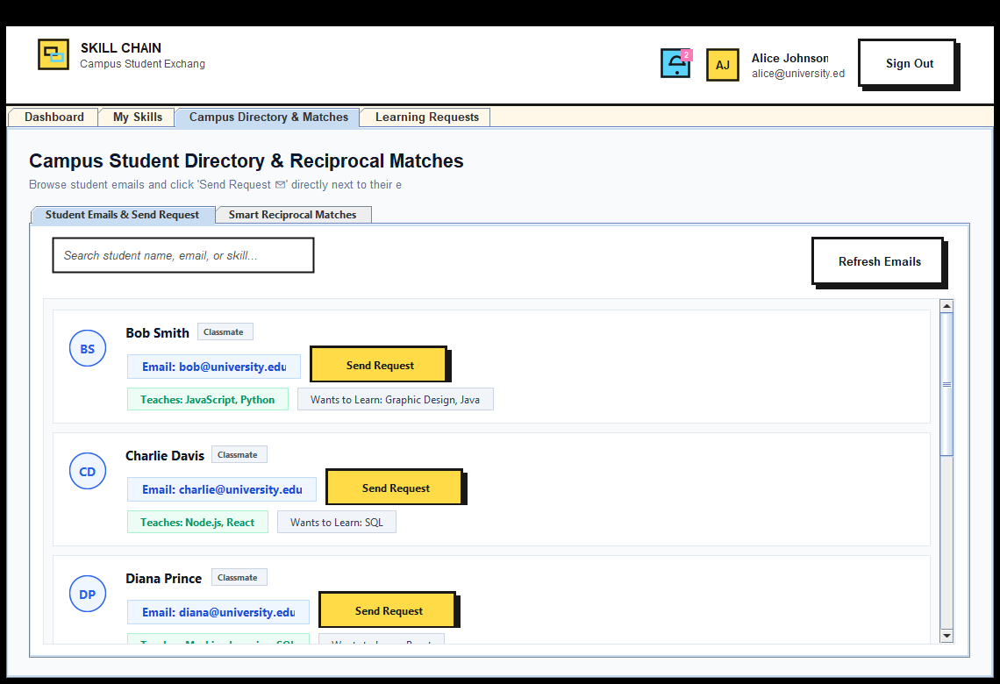
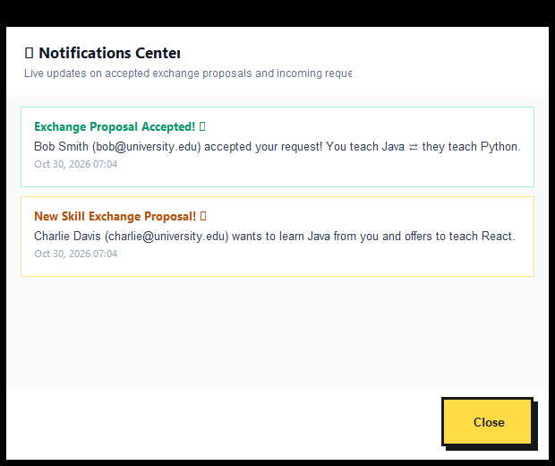

# Skill Chain Final Project Report

## Integrated Java OOP and DBMS Project

**Project:** Campus Peer-to-Peer Skill Exchange Platform  
**Institution:** Rajalakshmi Engineering College  
**Department:** ______________________________  
**Academic year:** ______________________________  
**Team members and register numbers:**  
1. ____________________________________________  
2. ____________________________________________  
3. ____________________________________________

## Bonafide Certificate

This is to certify that the project titled **Skill Chain: Campus Peer-to-Peer Skill Exchange Platform** is the work of the students named above, submitted in partial fulfilment of the requirements for the course project in Object-Oriented Programming and Database Management Systems during the academic year stated above.

**Project guide:** ______________________________  
**Head of department:** _________________________  
**Date:** __________________  **Place:** __________________

## Student Declaration

We declare that this project report describes the Java and MySQL application developed by our team. The implementation details and verification status in this report are based on the files and checks identified in the report. Any remaining live database checks are marked as pending.

**Student signatures:**  
1. __________________________  2. __________________________  3. __________________________

## Acknowledgement

We express our gratitude to ______________________________ for guidance during this project and to the Department of ______________________________ for providing the opportunity to complete it.

## Abstract

Skill Chain is a Java Swing desktop application that helps campus students find peers for no-cost, two-way skill exchange. A student records the skills they can teach and the skills they want to learn. The application searches for another student whose teaching and learning interests complete that exchange, then lets the students manage a proposal as a learning request.

The application uses Java 17, JDBC, and MySQL. Its four relational tables store users, the skill catalogue, user-to-skill associations, and exchange requests. Primary keys, foreign keys, uniqueness constraints, checks, and indexes protect data relationships. Java packages separate the user interface, service logic, DAO contracts and implementations, domain models, and utilities. The code demonstrates encapsulation, abstraction, inheritance, method overriding and overloading, custom exception handling, and JDBC CRUD operations.

The Java sources compile with JDK 17, and the database-independent OOP smoke check passes after the current password-hash changes. Live MySQL integration cases still require execution against a configured local server; the test plan records those cases as pending rather than treating them as passed.

## Table of Contents

1. Chapter 1: Introduction
2. Chapter 2: Requirements and Feasibility
3. Chapter 3: System Analysis and Design
4. Chapter 4: Database Design
5. Chapter 5: Implementation
6. Chapter 6: Verification and Test Plan
7. Chapter 7: Security, Limitations, and Maintenance
8. Chapter 8: Conclusion and Future Work
9. References
10. Appendix A: SQL Schema
11. Appendix B: Output Screenshots

## Chapter 1: Introduction

### 1.1 Background

Students often want help with a subject or tool that another student already knows. Informal requests in class groups are difficult to search, and they do not show whether the other student also wants to learn a skill in return. Skill Chain organizes those interests in one searchable desktop application.

### 1.2 Problem Statement

Students need a simple way to find a campus peer who can teach a skill they want to learn and who is also interested in learning something the first student can teach. The system must store these portfolios, find mutual matches, and record proposals without losing referential integrity.

### 1.3 Objectives

- Register and authenticate student accounts.
- Maintain a student portfolio of skills to teach and skills to learn.
- Search the skill catalogue and the campus directory.
- Find reciprocal teaching and learning pairs from stored portfolio data.
- Create, view, accept, and reject exchange requests.
- Demonstrate Java OOP concepts alongside relational DBMS operations.

### 1.4 Scope

Skill Chain is a local desktop project for demonstrating a campus skill exchange workflow. It is not a public web service or a production deployment. MySQL credentials are configured on the machine running the application.

## Chapter 2: Requirements and Feasibility

### 2.1 Functional Requirements

| ID | Requirement |
|---|---|
| FR1 | A student can register and log in using an email and password. |
| FR2 | A student can add, list, search, and remove skills from their portfolio. |
| FR3 | A student can view a peer directory and their reciprocal matches. |
| FR4 | A student can send an exchange proposal and view incoming or outgoing requests. |
| FR5 | The addressed receiver can accept or reject a pending request. |
| FR6 | The dashboard can show portfolio counts, reciprocal matches, and request information. |

### 2.2 Non-Functional Requirements

- Store relational data in MySQL and access it through JDBC.
- Use prepared statements and close JDBC resources reliably.
- Preserve referential integrity between users, skills, portfolios, and requests.
- Keep passwords out of the database in plaintext.
- Present the workflow in a desktop interface that runs on JDK 17 or later.

### 2.3 Feasibility

**Technical:** Java Swing, JDBC, and MySQL satisfy the project requirements and run on a standard JDK 17 workstation with MySQL 8.0.  
**Operational:** The workflow uses familiar registration, portfolio, match, and request screens. Students can demonstrate it with the seeded accounts.  
**Economic:** The project uses the JDK, MySQL Community Server, and MySQL Connector/J; it does not require a paid service for a local demonstration.

### 2.4 Environment

| Component | Requirement |
|---|---|
| Language/runtime | Java 17 or later |
| User interface | Java Swing |
| Database | MySQL 8.0 or later |
| Connectivity | JDBC with MySQL Connector/J 8.4.0 |
| Build | Maven, or the provided Windows batch scripts |

## Chapter 3: System Analysis and Design

### 3.1 Architecture

The desktop interface sends user actions to service classes. Services apply project rules and call DAO interfaces. JDBC DAO implementations use prepared statements to read or change MySQL rows. Domain models carry the resulting user, skill, and request data back to the interface.

```text
Student
  |
  v
Swing UI (ui) -> Service layer (service) -> DAO contracts (dao)
                                            |
                                            v
                                   JDBC DAO implementations
                                            |
                                            v
                                       MySQL schema

Domain objects (model) are passed between the UI, services, and DAOs.
Utilities (util) provide connection configuration, password hashing,
and application-specific exceptions.
```

### 3.2 Main Workflows

**Registration and login:** The UI validates the form, the service validates the input and derives a password hash, and the user DAO stores or retrieves the account. A successful login opens the main application window.

**Portfolio and matching:** A student adds `TEACH` and `LEARN` rows. The matching service joins those records to another student's portfolio and returns pairs only when the teaching and learning interests overlap in both directions.

**Exchange request:** A student sends a proposal. The receiver can accept or reject it while it is pending. The update is constrained by both the request ID and the authenticated receiver's user ID.

### 3.3 Design Boundaries

The UI handles display and input. Service classes hold application decisions. DAO interfaces describe persistence operations, while JDBC implementations handle SQL. This separation makes the persistence contract explicit and gives the project concrete examples of abstraction and package organization.

## Chapter 4: Database Design

### 4.1 Entity Relationships

```text
users 1 ---- many user_skills many ---- 1 skills
users 1 ---- many learning_requests (sender)
users 1 ---- many learning_requests (receiver)
skills 1 ---- many learning_requests (offered skill)
skills 1 ---- many learning_requests (requested skill)
```

`user_skills` resolves the many-to-many relationship between users and skills. Its `skill_type` column records whether a student teaches or wants to learn that skill.

### 4.2 Tables and Keys

| Table | Purpose and key fields |
|---|---|
| `users` | Student profile; `user_id` is the primary key; `email` is unique; stores encoded hash, salt, and creation time. |
| `skills` | Shared skill catalogue; `skill_id` is the primary key; `skill_name` is unique. |
| `user_skills` | Student portfolio junction; `user_skill_id` is the primary key; `user_id` and `skill_id` are foreign keys. |
| `learning_requests` | Exchange proposal; `request_id` is the primary key; sender, receiver, offered skill, and requested skill are foreign keys. |

### 4.3 Integrity and Indexing

The schema uses InnoDB foreign keys with cascading deletes for dependent portfolio and request rows. A unique constraint on `(user_id, skill_id, skill_type)` prevents duplicate portfolio entries. A check prevents self-directed requests. Request status is limited to `PENDING`, `ACCEPTED`, or `REJECTED`. Indexes support reciprocal matching and request lookup by student, status, and creation time.

The schema separates the skill catalogue from each student's portfolio, so a skill name and category are stored once. The junction table stores the relationship and type. This reduces repeated skill text and keeps updates consistent.

## Chapter 5: Implementation

### 5.1 Package Structure

| Package | Main responsibility | Representative classes |
|---|---|---|
| `com.skillchain.model` | Domain objects and validation | `Person`, `User`, `Skill`, `LearningRequest` |
| `com.skillchain.dao` | Persistence abstractions and JDBC | `UserDao`, `SkillDaoImpl`, `LearningRequestDaoImpl` |
| `com.skillchain.service` | Application rules and workflows | `UserService`, `SkillService`, `MatchingService`, `RequestService` |
| `com.skillchain.ui` | Swing application screens | `LoginRegisterFrame`, `MainFrame` |
| `com.skillchain.util` | Shared infrastructure and exceptions | `DatabaseConnection`, `PasswordUtil`, `DatabaseException` |

### 5.2 OOP Concepts in the Code

| Concept | Implementation |
|---|---|
| Encapsulation | Model fields are private; constructors and setters validate values. |
| Abstraction | `Person` is abstract; DAO interfaces define persistence contracts separately from JDBC classes. |
| Inheritance | `User` and `PeerStudent` extend `Person`. |
| Runtime polymorphism | `User` overrides `getRole()` and `getSummary()`; a `Person` reference can refer to a `User`. |
| Compile-time polymorphism | Skill search and portfolio read methods are overloaded for keyword/category and skill-type variants. |
| Packages | UI, services, DAO, models, and utilities are grouped under separate Java packages. |
| Exception handling | Domain exceptions distinguish duplicate email, duplicate skill, and invalid login; JDBC failures are represented by `SQLException` and handled at the UI boundary. |

### 5.3 JDBC and CRUD Operations

| Operation | Application example | Database effect |
|---|---|---|
| Create | Register a student, add a portfolio skill, or send a proposal | `INSERT` into `users`, `user_skills`, or `learning_requests` |
| Read | Load a portfolio, directory, match list, or requests | `SELECT` with filters and joins |
| Update | Accept or reject a pending exchange request | `UPDATE` request status for the addressed receiver only |
| Delete | Remove a student's own portfolio entry | `DELETE` constrained by both portfolio row ID and owner ID |

DAO methods use `PreparedStatement` parameters. JDBC connections, statements, and result sets use try-with-resources so they close when each operation finishes.

### 5.4 Reciprocal Match Rule

A peer is returned when both conditions are true:

1. The current student teaches a skill the peer wants to learn.
2. The peer teaches a skill the current student wants to learn.

`MatchingService.findReciprocalMatches` applies these conditions in a four-way join on `user_skills`, then joins users and skills for the display names. This makes the match a database-backed result rather than a hard-coded recommendation.

### 5.5 Password Storage and Migration

New passwords use PBKDF2-HMAC-SHA256 with 600,000 iterations and a unique 16-byte random salt. The encoded hash records its algorithm and work factor. The verifier accepts the earlier salted SHA-256 format for existing demo accounts; after a correct login, `UserService` stores a PBKDF2 hash and a fresh salt. The schema expands the hash column to fit the encoded value. The work factor follows the current OWASP Password Storage Cheat Sheet guidance for PBKDF2-HMAC-SHA256.

## Chapter 6: Verification and Test Plan

### 6.1 Verification Run

The Java sources were compiled with `javac --release 17` on 25 November 2026. The database-independent `CoreOopVerification` smoke check then completed with the output `Core OOP verification passed.` It covers inheritance and method overriding, model validation, enum parsing, recursive category traversal, PBKDF2 verification, malformed salt handling, and compatibility with a seeded legacy demo hash.

No live MySQL connection was configured for this workspace run. Database integration cases below remain pending until the team executes them against its configured MySQL 8.0 database and records the result.

### 6.2 Test Matrix

| ID | Test | Expected result | Current status |
|---|---|---|---|
| V01 | Compile Java sources for release 17 | All application classes compile | Pass, 25 Nov 2026 |
| V02 | Run `CoreOopVerification` | Smoke check prints its pass message | Pass, 25 Nov 2026 |
| DB01 | Execute `schema.sql` on MySQL 8.0 | Database, four tables, indexes, constraints, and seed rows exist | Pending live MySQL run |
| DB02 | Register a new student, then inspect `users` | One account row is added with a PBKDF2 hash and salt | Pending live MySQL run |
| DB03 | Log in with a seeded legacy account | Login succeeds and the stored hash changes to PBKDF2 | Pending live MySQL run |
| DB04 | Add, list, search, and remove a portfolio skill | CRUD operations affect only the signed-in student's portfolio | Pending live MySQL run |
| DB05 | Load the seeded reciprocal pair | Alice/Bob and Charlie/Diana each appear as mutual matches | Pending live MySQL run |
| DB06 | Send a proposal and list incoming/outgoing requests | The request appears with `PENDING` status | Pending live MySQL run |
| DB07 | Accept/reject as receiver; attempt update as another user | Only the addressed receiver can transition a pending request | Pending live MySQL run |
| DB08 | Stop MySQL and refresh data | The UI shows a controlled database error | Pending live MySQL run |

For every live test, record the date, tester, demo account, input, actual result, pass/fail result, and screenshot or SQL output in `docs/VERIFICATION_RESULTS.md`.

## Chapter 7: Security, Limitations, and Maintenance

### 7.1 Security Controls

- Passwords are stored as salted PBKDF2 hashes; the old demo format is upgraded after successful authentication.
- JDBC statements use parameters rather than concatenating user input into SQL.
- Foreign keys, uniqueness, check constraints, and status values protect database consistency.
- Portfolio deletion checks ownership. Request decisions check both receiver ownership and pending status in the SQL update.
- Local database credentials are kept in `config.properties`, which is ignored by Git.

### 7.2 Limitations

- The current verification run did not include a configured live MySQL server. The pending integration tests must be completed before final submission.
- The application is a local Swing demonstration, not a deployed campus service. The supplied sample accounts and password are public demo credentials.
- JDBC actions run from Swing event handlers, so a slow database can make the interface pause. A later version can move database work to `SwingWorker`.
- The directory displays student email addresses to logged-in users. A deployed version should add consent and profile privacy controls.
- Database connection settings are intended for local development. A deployed database should use managed credentials and verified TLS.

### 7.3 Maintenance

Run the database script when creating a fresh environment. For an existing database, the script widens `users.password_hash`; back up the database before changing a shared environment. Keep the JDBC driver and Java runtime aligned with the build file. Re-run the OOP smoke check after model or password changes, and complete the live database test matrix after DAO or schema changes.

## Chapter 8: Conclusion and Future Work

Skill Chain implements a complete campus skill exchange path: students record teaching and learning interests, the matching service finds mutual opportunities, and students can manage exchange proposals. Java packages and OOP models organize the application, while JDBC DAOs connect the service layer to a relational MySQL schema with CRUD operations and integrity constraints.

The source compiles and the database-independent OOP smoke check passes. The next submission step is to run the pending MySQL integration tests, capture current output screens, and fill in the team and faculty details on the preliminary pages.

Future work includes running database tasks off the Swing event thread, adding privacy settings and institutional account verification, and adding an administrator workflow for catalogue maintenance.

## References

1. Oracle. *Java SE Documentation*. https://docs.oracle.com/en/java/
2. Oracle. *MySQL 8.0 Reference Manual*. https://dev.mysql.com/doc/refman/8.0/en/
3. OWASP. *Password Storage Cheat Sheet*. https://cheatsheetseries.owasp.org/cheatsheets/Password_Storage_Cheat_Sheet.html
4. Oracle. *MySQL Connector/J Developer Guide*. https://dev.mysql.com/doc/connector-j/en/

## Appendix A: SQL Schema

The complete executable schema, including table definitions, primary keys, foreign keys, uniqueness and check constraints, indexes, demo users, skills, portfolios, and request rows, is maintained in [`schema.sql`](../schema.sql). Run that file in MySQL Workbench or the MySQL command-line client before launching the application.

## Appendix B: Output Screenshots

The following application screens are included as output evidence. The current repository's reciprocal-match image is from a different data set than the checked-in demo seed rows; regenerate it after loading `schema.sql` before using that screen in the final submission.

| Screen | Evidence file |
|---|---|
| Login | [`01_Login_Screen.png`](screenshots/01_Login_Screen.png) |
| Registration | [`02_Registration_Screen.png`](screenshots/02_Registration_Screen.png) |
| Dashboard | [`03_Dashboard_Overview.png`](screenshots/03_Dashboard_Overview.png) |
| My skills portfolio | [`04_My_Skills_Portfolio.png`](screenshots/04_My_Skills_Portfolio.png) |
| Skill category tree | [`05_Skill_Category_Tree_Hierarchy.png`](screenshots/05_Skill_Category_Tree_Hierarchy.png) |
| Campus directory | [`06_Campus_Directory.png`](screenshots/06_Campus_Directory.png) |
| Incoming requests | [`08_Incoming_Requests.png`](screenshots/08_Incoming_Requests.png) |
| Outgoing requests | [`09_Outgoing_Requests.png`](screenshots/09_Outgoing_Requests.png) |
| Notifications | [`10_Notifications_Center.png`](screenshots/10_Notifications_Center.png) |

### B.1 Login Screen



### B.2 Dashboard



### B.3 Student Skill Portfolio



### B.4 Campus Directory



### B.5 Notifications



